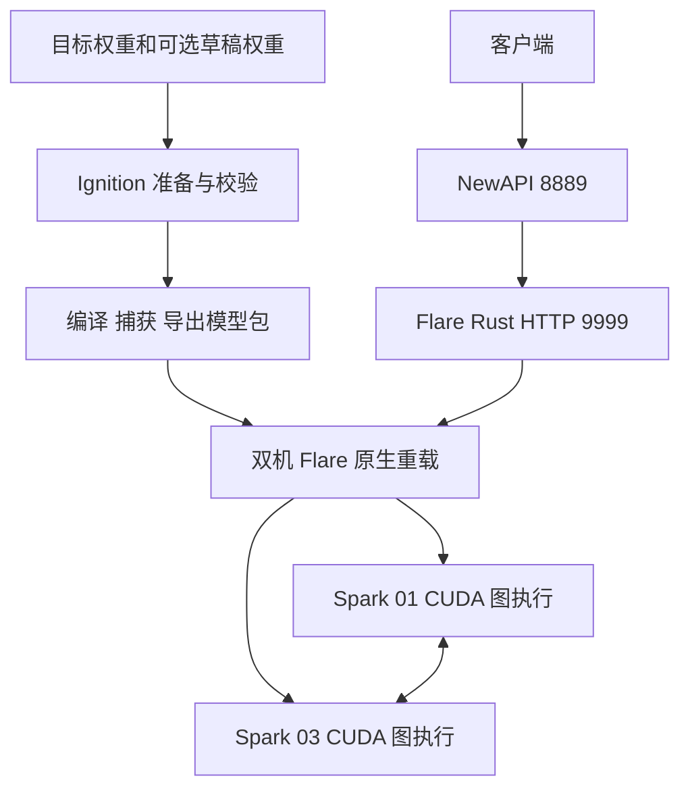

# GLM 5.3 适配总结与其他模型接入指南

更新日期：2026 年 10 月 22 日。

本次工作把双 NVIDIA DGX Spark 上的 GLM 5.3 服务迁移到 Flare，接回原有 NewAPI 8889 入口，保留既有 EXL3 专家权重、非专家与视觉权重精度、自定义聊天模板、静态图片输入和默认思考设置。随后接入外部 DFlash2 投机解码，建立性能对照脚本，并将生产配置切为 `throughput + 4 草稿`。

服务已运行，选定的功能检查通过；**完整模型输出一致性仍未通过**，尤其普通解码与 DFlash2 存在逐 token 分叉。因此，“完成部署”“通过功能检查”和“证明与原模型等价”要分别看待。

相对上游的改动以分支起点 `47581cc` 为参照。上游当时已有 GLM 5.3 文本 recipe、NVFP4/MXFP8 权重路径、CUDA 图执行和共享投机调度机制；本次是在这些基础上适配办公室实际使用的 EXL3/BF16、多模态与双 Spark 部署。

## 当前交付状态

| 项目 | 当前状态 |
| --- | --- |
| 设备 | spark-01 与 spark-03，跨机 TP2 |
| 用户入口 | NewAPI 8889；原生 Flare HTTP 为 9999，由 rank 0 提供 |
| 模型名称 | 接受 `GLM-5.3-Flash-EXL3` 和 `spark/GLM-5.3-Flash-EXL3`；回复使用前者 |
| 目标权重 | routed experts 保留 EXL3 K4 MCG；其他权重保留既有精度，含指定 BF16 `o_proj` donor |
| 图片 | 支持静态图片；本部署每张最多 2048 image tokens，每请求最多 20 张 |
| 投机解码 | 外部 DFlash2 已进入捕获、导出、原生重载与服务执行链路 |
| 生产参数 | `--scheduler-policy throughput --mtp-draft-tokens 4` |
| 其他设置 | 默认思考、`after_reasoning` 字符串停止范围、并发上限 4 保持原值 |
| 已验证范围 | 文本、图片、SSE、工具调用、取消、并发、选定长输入与缓存边界 |
| 未完成范围 | 完整数值等价、全面质量评测、视频、65536 token 完整输出长度与重启容灾验收 |

65536 是本部署省略输出长度时的默认上限；短请求通过不代表该完整长度已测过。图片限制也受模型包实际准备的图容量和上下文容量约束。

## 推理与准备流程

准备阶段使用 Python、PyTorch 和原实现的参考内核，完成权重加载、算子准备、编译和捕获。服务阶段由 Rust 管理请求、分词、缓存和 CUDA 图重放，生产进程不依赖 Python 回调或即时执行模型。两台机器各有自己的模型文件与 rank 数据。

迁移工作因此同时涉及“怎么读权重”“如何计算”“如何保存完整状态”和“如何对外提供相同接口”。只认出专家层名称，无法覆盖整条链路。

## GLM 适配具体改了什么

### 权重识别和原部署输入

本地 checkpoint 根据架构与 `quantization_config` 选择 EXL3 变体，检查真实 safetensors 头部、张量名称、形状、存储类型和字节范围，并按 TP2 切分方式重新计算常驻内存。检查器补上了 EXL3 使用的 F16、I16、I32 存储类型。

本部署还需要保留自定义 chat template 和指定 BF16 `o_proj` donor。新增的迁移 checkpoint 工具先核对 donor，再生成独立目录；需要修改的 shard 复制后处理，其余 shard 保持原数据引用。原权重没有为了接入 Flare 而统一转成上游 NVFP4。

主要代码：[变体与容量声明](../ignition/recipes/glm53/recipe.py)、[GLM 权重加载](../ignition/recipes/glm53/weights.py)、[checkpoint 检查](../ignition/preparation/checkpoint.py)、[迁移 checkpoint 工具](../qualify/glm_migration_checkpoint.py)。

### EXL3 专家计算

专家加载器增加 EXL3 K4 MCG 读取、scale 校验、TP2 切片和专家指针表。这里采用张量并行：每个 rank 保留全部专家的对应分片，不能把它理解为“一台机器只放一半专家”。

执行路径接入原部署的 cooperative decode 内核，以及 thin/E3 prefill 内核。prefill 是处理输入上下文，decode 是逐步生成输出；两者的行数、分派和算术路径不同。曾测过把大 prefill 拆成多次 cooperative 调用，但算术与原实现不一致，未采用。

此外处理了固定图容量大于实际有效 token 数的情况：无效行、masked routes、零有效行和复用 scratch 都不能污染专家计数或有效输出。相关检查覆盖原始实现、编译、捕获和新原生进程重放，确认选定样本精确一致及重放时 GPU 分配稳定。

主要代码：[EXL3 计算组件](../ignition/components/exl3.py)、[prefill 组件](../ignition/components/exl3_prefill.py)、[格式校验](../ignition/preparation/exl3.py)、[prefill 准备](../ignition/preparation/exl3_prefill.py)。

### BF16 非专家计算

原有 GLM recipe 面向另一套量化权重，本部署的非专家投影需要保留 BF16。因此增加按真实存储类型选择的投影路径，并接入 BF16 MLA 吸收与展开矩阵乘法，调整 KDA、MLA、indexer、共享专家及 decoder 的调用。

精度还包括运算顺序。BF16 文本 RMSNorm 使用原部署内核，避免直接套用量化路径的舍入顺序；indexer 门控保留要求的 FP32 输出。针对这些改动建立了独立参考检查，防止“权重相同，算出来已经不同”。

主要代码：[投影与归一化](../ignition/recipes/glm53/projections.py)、[KDA](../ignition/recipes/glm53/kda.py)、[MLA](../ignition/recipes/glm53/mla.py)、[indexer](../ignition/recipes/glm53/indexer.py)、[参考校验](../qualify/glm_text_norm_reference.py)。

### 静态图片输入

图片能力补齐了 CPU 前处理与 GPU 视觉模型两部分。CPU 端实现 resize、padding、FP32 CLIP normalization、temporal patch 打包、二维位置和 image-token 布局；GPU 端加载视觉权重，准备 encoder、merger 和语言 embedding 注入路径。

图片特征还要正确跨越分块 prefill 与前缀缓存边界，因此加入 feature slot、generation 与 offset 管理，检查图片 A、图片 B、再次图片 A 时的隔离和复用。实际测试覆盖两张图片合计 4096 image tokens，跨越 4096-token prefill 边界。

部署处理器生成了 9 组 CPU 图像参考用例；SM121 上另外验证视觉图的 scratch 生命周期与原生重放。该路径提供静态图片支持，视频所需的帧采样、时间戳与布局仍待实现。

主要代码：[Rust 图像前处理](../helios/src/frontend/images/glm.rs)、[布局](../helios/src/frontend/images/layouts/glm.rs)、[视觉计算](../ignition/recipes/glm53/vision.py)、[视觉权重](../ignition/recipes/glm53/vision_weights.py)、[视觉状态](../ignition/recipes/glm53/vision_state.py)。

### 双机准备和本地读权重

准备初期，rank 1 从 rank 0 按范围取权重，再经过临时缓冲文件进入 GPU，串行路径成为明显瓶颈。两台 Spark 本来各有本地权重，因此新增经过认证校验的本地 checkpoint 读取。

远端元数据仍用于确认同一模型，随后校对本地目录与整文件 SHA256；读取时固定文件身份并使用本地原生批量 I/O，防止校验后文件被替换。完成的准备记录确认 rank 1 未传输远端 tensor payload。

这是**准备阶段**的改进。最终导出包仍需发布每个 rank 的实际数据；跨机 TP 推理仍通过专用网络通信。本地加载不意味着两台模型目录共享，也不意味着推理不再通信。

主要代码：[checkpoint source](../ignition/preparation/checkpoint_source.py)、[本地与远端权重读取](../ignition/preparation/remote_weights.py)、[跨机准备](../ignition/preparation/host_ranks.py)。

### 原生 API 和 NewAPI 兼容

原有客户端继续走 8889。Flare 增加可配置模型别名、默认输出上限、思考阶段停止范围，以及本部署需要的采样与 token mask 行为；零温度采样在约束和惩罚之后选择 argmax，并列时选较小 token ID。相关机制放在共享前端和采样组件中。

NewAPI 启用请求体透传，使 `stop_scope` 等原生字段到达 Flare。透传也保留带 `spark/` 的请求模型名，因此原生服务同时接受两个别名。验收分别检查请求名称与回复名称，以及文本、图片、SSE、工具调用、token 用量、取消和并发。

主要代码：[native CLI](../flare/src/cli.rs)、[请求解码](../helios/src/server/protocol/decode.rs)、[停止处理](../helios/src/server/stops.rs)、[greedy 分布](../ignition/components/greedy.py)。详细接口验收见 [GLM service acceptance](glm-service-acceptance.md)。

### 外部 DFlash2 投机解码

目标模型先保留原有权重，再加载配套 BF16 DFlash2 草稿模型。草稿从目标模型指定层提取特征，提出多 token 候选；目标模型验证后提交接受部分，并更新后续草稿上下文。

接入内容包括草稿权重校验、5 层 draft forward、2048-token 环形 KV 窗口、候选选择，以及目标 KDA、卷积、index 历史和草稿 KV 的完整提交与恢复。宽度为 1 时仍走普通目标 decode，同时维护草稿上下文，保证之后能够恢复更宽的验证。

这些计算放在 GLM recipe 与捕获图中，复用已有的原生 speculative 调度机制。本次 DFlash2 接入没有增加新的图操作契约、包 schema 或 Rust 模型算法。

配套模型是 `incoai/GLM-5.3-Flash-DFlash2` 的已校验本地版本。它与 checkpoint 内置 MTP 使用不同准备路径；其他模型要使用外部 drafter，需要单独匹配其结构和状态。本次 GLM 服务没有接入 dspark 路径；仓库其他模型已有相关组件，但其权重和目标特征约定不能直接套到 GLM。

主要代码：[草稿权重](../ignition/recipes/glm53/dflash_weights.py)、[draft forward](../ignition/recipes/glm53/dflash.py)、[投机图组合](../ignition/recipes/glm53/dflash_speculative.py)、[完整状态布局](../ignition/recipes/glm53/pool.py)。

## 验证结果和仍待解决的问题

普通模型包先完成编译、捕获、签名导出和双机新进程重载，再接 DFlash2；两种包均保留。DFlash2 包完成 66 张服务图捕获，双机通过存储权重验证后运行。

选定 DFlash2 服务用例合计 52 项：38 项 native/NewAPI API 检查、10 项图片缓存及长提示检查、4 项不同输出尾长的并发请求。CPU 与 GPU 组件另有独立检查，包括图像前处理、EXL3 算术、BF16 normalization、采样和草稿窗口写入。各项覆盖范围见 [部署记录](beiyu-glm.md)。

完整数值验收仍失败：最初普通解码与 DFlash2 的 4 次公开用例对照只有 2 次精确匹配，英文从生成 token 索引 41 开始分叉；后续复现也出现索引 55 分叉。固定 seed 与零温度未消除差异。

已确认实际权重下的 mHC 计算存在宽度敏感性：相同首行输入，宽度 1 与 8 有 2/4096 个 BF16 分量不同。原生 argmax 与并列规则检查通过，但尚未证明完整模型的第一次偏离由哪个算子触发。下一步应从相同初始完整状态和固定 token 前缀逐层追踪，并继续检查验证、拒绝回放、宽度切换与缓存恢复。

功能通过不能替代这项验收，也尚无全面质量评测量化输出差异。原始失败结果及数值边界保留，详细问题见 [DFlash2 输出差异](glm53-dflash2-output-divergence.md)。

## 性能实验和生产选择

建立了可重复运行的程序化对照：固定公开输入、记录实际配置、执行预热、使用 native token 时间戳计算速度，并检查请求计数、缓存条件、token 工作量与输出序列。首轮 10 组共 240 请求；之后采用“原配置、候选、原配置、候选、原配置”交错复测，再执行 240 请求。

下面是交错复测的解码吞吐中位数，单位 token/s；各用例每组测 6 次。原配置为 7 草稿 / balanced。

| 配置 | 中文 | 英文 | 长上下文 | 带图 |
| --- | ---: | ---: | ---: | ---: |
| 原配置起始对照 | 30.91 | 24.92 | 27.35 | 29.39 |
| 3 草稿 / throughput | 36.08 | 34.15 | 30.04 | 32.85 |
| 原配置中间对照 | 26.06 | 17.46 | 27.57 | 29.98 |
| 4 草稿 / throughput | 36.28 | 39.78 | 28.58 | 33.99 |
| 原配置收尾对照 | 31.49 | 28.73 | 27.08 | 28.81 |

这是热前缀、64 或 128 输出 token 预算下的诊断计时。原配置英文有明显波动，部分请求没有接受草稿；原配置自身也有输出变体。候选尚未全部通过输出一致性，不能据此宣称普遍或等价推理的提速比例。

2026 年 10 月 22 日，在上述限制已说明后，用户选择 **4 草稿 / throughput** 作为生产配置。两台实际进程参数均已核对，切换后 8889 的文字与图片调用通过。并发上限仍为 4，没有为单人使用改成强制串行。

其他优化也做了实验，但均未进入生产：

| 尝试 | 结果 | 后续条件 |
| --- | --- | --- |
| 全词表通信改为局部候选交换与合并 | 组件约 801.89 µs → 62.56 µs，但 6 个正确性输入中 3 个失败，包含实际权重和并列边界 | 先解决候选集合与并列语义，再测完整图与服务 |
| KDA 独立分支并行 | 组件局部耗时下降约 0.8%–2.9% | 需测完整 forward、跨 rank 和全部容量 |
| 共享专家与 routed experts 并行 | 晚发组件约改善 0.2%–1.5%；早发部分配置回退约 1.9% | 收益小，需验证完整图与 scratch 生命周期 |

复测脚本：[基线与比较](../qualify/glm_service_benchmark.py)、[调度复测](../qualify/glm_scheduler_recheck.py)、[复测汇总](../qualify/glm_scheduler_recheck_summary.py)、[GPU 组件诊断](../qualify/glm_gpu_optimizations.py)。运行方式与完整结果见 [性能记录](glm53-performance-20261022.md)。这些脚本没有改变生产推理实现。

## 部署和存储整理

两台均使用 `flare-beiyu.service` 用户服务，运行目录为 `/workspace/runtime/flare-beiyu`，模型包位于 `/workspace/outputs/flare-beiyu`。同一签名主包标识两台 rank，启动时保留 `--verify-weights`。准备环境退出后才启动原生服务，避免两套栈同时占用 GPU。

当前启动脚本为 `service/start-native.sh`，旧 7/balanced 配置备份为同目录 `start-native.sh.before-throughput4-20261022`。回退时先停止两台服务，分别恢复备份，再启动两台并检查 9999 与 8889。更早的普通解码包与 DFlash2 切换备份也保留；只回退调度参数与回退整个 DFlash2 包是不同操作。

按用户要求，将 spark-01 的其他模型权重归档到 spark-03 外接盘 `/mnt/spark-data/model-archive/spark-01-20261021`，独立 SHA256 校验后才移除源文件，保留当前 GLM 及相关权重、运行包和代码。完成时 spark-01 约有 2.4 TiB 可用空间；外接盘剩余约 194 GiB，数值为整理完成时记录。

spark-01 的 `/workspace/readme.md` 保存目录说明、归档恢复和当前生产参数。外接盘归档提供存储空间，当前推理仍使用已部署的 GLM 文件。

## 未来适配其他模型要改哪些层

### 先区分权重格式与模型架构

**同一架构换权重，主要工作通常在权重与准备层；换架构则要重新检查计算和完整状态。** 当前 GLM 读取器明确校验 45 层、4096 hidden、288 routed experts 等几何条件，EXL3 变体也限定已验证的 TP2 路径。它们是实际支持范围，改模型名或放宽检查不能自动获得新模型支持。

这里还有两个容易混淆的“解码”：权重解包把量化表示交给相应矩阵计算内核；token 解码负责模型 forward、采样、缓存更新和输出生成。专家识别只是权重映射中的一部分，token 解码则依赖整个模型的运算与状态。

| 新模型情况 | 大概率需要修改 | 可以优先复用 |
| --- | --- | --- |
| 同架构、同几何、同受支持格式，仅换兼容微调权重 | checkpoint 路径与元数据核对、模板与采样默认值检查，重新准备导出及回归；可能无需改计算代码 | 已有 recipe、loader、缓存、视觉和原生服务 |
| 同架构，换量化或混合精度方案 | loader、打包布局、scale、TP 切片、矩阵与专家组件、内存估算；必要时重新匹配 normalization 算术 | 模型大体数据流与已有状态机制 |
| 同一家族但层数、hidden、专家数、路由或 attention 几何改变 | 几何校验、recipe、权重映射、状态布局、图容量和分片策略；逐项确认算子支持 | 符合新几何的共享组件 |
| 新架构，含不同 attention、循环层或条件路由 | 新 recipe 或扩展相近 recipe；forward、位置编码、mask、cache 与状态提交恢复 | Rust 请求与调度机制、已有算子和包加载 |
| 新视觉模型或视频 | 图像/帧处理、token 布局、vision encoder、projector/merger、特征注入与缓存边界 | 符合契约的图像运输、窗口和共享缓存机制 |
| 新外部草稿模型或其他投机方法 | 草稿权重与目标特征对齐、draft forward、候选与验证、完整 speculative 状态和宽度切换 | 已有通用 proposal/verification 调度，前提是表达得了所需契约 |

采样默认值和允许范围要按模型作者的推荐手工声明；checkpoint 配置用于校验结构，不能直接替代采样策略。不同 tokenizer、思考分隔符和工具格式也会影响行为。即使参数形状相同，模板、EOS、停止词和采样设置不同，客户端看到的模型行为仍可能改变。

### 按职责修改代码

| 层次 | 主要位置 | 适配时要回答的问题 |
| --- | --- | --- |
| 模型识别与计划 | `ignition/recipes/__init__.py`、模型 `recipe.py` | 用哪个 recipe、哪些 rank/容量可用、内存是否放得下 |
| 权重读取 | 模型 `weights.py`、`ignition/components/weights.py`、格式准备模块 | tensor 名称、存储类型、scale、布局与分片是否正确 |
| 模型计算 | 模型 decoder/attention/MoE 模块与 `ignition/components/` | forward、路由、归一化和数值精度是否符合原模型 |
| 缓存与状态 | 模型 state/pool/contract、共享 cache 契约 | KV 之外还有哪些历史；分支、前缀恢复和回滚是否完整 |
| 多模态 | `helios/src/frontend/images/`、模型 vision 模块 | 前处理、位置、token 成本与图像特征是否一一对应 |
| 前端行为 | frontend 元数据、tokenizer/template、共享 parser | 文本、思考、工具、停止与采样行为是否匹配 |
| 捕获导出 | 模型 `bootstrap.py`、`ignition/preparation/` | 所有容量是否完成准备、编译、捕获并可被新进程重载 |
| 投机解码 | 模型 draft/speculative 模块 | 草稿与目标如何对齐；拒绝、恢复和宽度 1 是否正确 |
| 验收与性能 | `tests/`、`qualify/` | 正确性、服务功能、内存和速度能否与等价基线比较 |

模型特有的计算应留在 Ignition recipe 与捕获图；共享机制放在 components。Rust 继续承担共享请求、缓存存储与调度机制。只有现有存储或前端契约无法表达真实需求时，才扩展相应共享接口；不能为每个新模型复制一套原生推理逻辑。包元数据变更还要保证旧包继续可用。

### 建议接入顺序

1. 确定原模型和精度参考，固定 tokenizer、template、donor、图像处理与采样设置，明确权重几何和已有 recipe 的差异。
2. 验证 loader 与单层计算，分别测 dense、expert、attention、normalization 和视觉组件；覆盖实际 TP 切片与无效行。
3. 先跑普通文本完整模型，核对 prefill/decode、位置和全部历史状态，再完成捕获、签名导出与原生新进程重载。
4. 接图片与原有 API，验证图像替换、跨窗口、缓存、工具、停止、取消与并发；客户端实际入口必须单独测。
5. 在普通路径稳定后接投机，核对接受、拒绝回放、宽度切换、完整状态恢复与逐 token 参考。
6. 保存新的基线，用相同模型、工作量、缓存和输出条件逐项测性能；通过正确性检查后再形成提速结论。

如果下一次仍是几何兼容的 GLM 5.3 EXL3 权重，大部分基础设施可以复用。最先检查的是它是否还满足当前读取器、BF16 donor、模板、视觉处理和配套草稿的假设；任何一项变化，都应先明确影响范围再重新导出模型包。

## 相关记录

- [完整部署与组件验证](beiyu-glm.md)
- [原生及 NewAPI 服务验收](glm-service-acceptance.md)
- [DFlash2 输出差异问题](glm53-dflash2-output-divergence.md)
- [性能基线和优化实验](glm53-performance-20261022.md)
- [上游模型开发约定](model-development.md)
- [待完成事项](TODO.txt)

实现主要提交：`1ef3c79`（迁移检查与前端）、`99f24dd`（EXL3/BF16、图像和原生 TP2）、`4fee85e`（DFlash2）、`4d3af4a` / `e9c07f3`（输出差异调查）、`4a9ca57` / `eb0ea7a`（性能脚本与实验）、`5a12b9c`（生产参数选择）。代码位于 [beiyu Fork 的 GLM 分支](https://github.com/beiyu/flare-local-inference/tree/beiyu/glm53-compat)。
